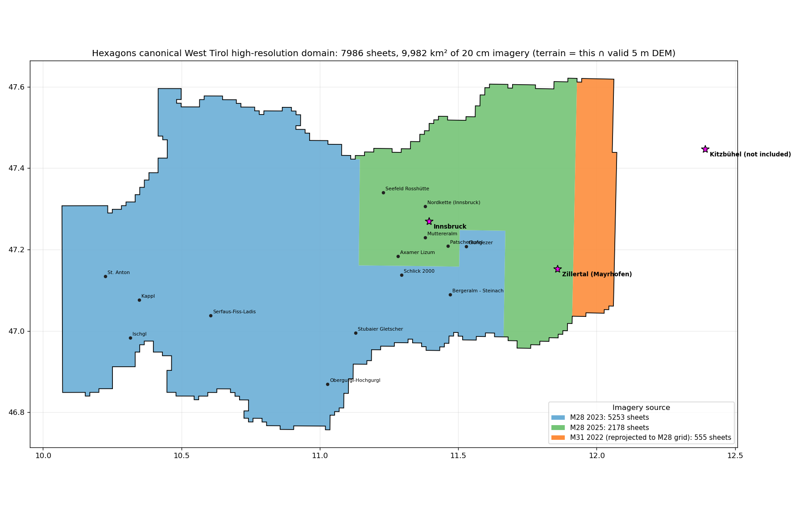

# Hexagons canonical West Tirol high-resolution domain (v2)

Decided with Cole on 2026-10-29. This is the area Hexagons renders at 20 cm
orthophoto / 5 m terrain detail, and the area the Nunatak student renders over.
It **supersedes** the administrative Tirol-minus-Lienz cutline in
[RECHNER_TIROL_UPGRADE.md](RECHNER_TIROL_UPGRADE.md): there is no cutline. The domain
is every orthophoto sheet we hold, one per footprint, and the bake keeps only terrain
that also has valid 5 m DGM Tirol.

- Machine-readable footprint: [config/coverage/hexagons_domain_v2.geojson](../config/coverage/hexagons_domain_v2.geojson)
  (exact 1250 x 1000 m sheet rectangles in EPSG:31254, densified to WGS84; no simplification).
  SHA-256 `55508e34676aa101d0765d837a715b63fca042e2bc0bad1de0b255db9cc8a6bf`.
- Sheet manifest with checksums: [hex_backend/aerial_source_inventory_v2.tsv](../hex_backend/aerial_source_inventory_v2.tsv)
  (7,986 files, 61,088,777,655 bytes).

| Source layer | Sheets | Area km2 |
|---|---:|---:|
| M28 2023 | 5,253 | 6,566 |
| M28 2025 | 2,178 | 2,723 |
| M31 2022, reprojected onto the M28 grid | 555 | 694 |
| **Domain (union)** | **7,986** | **9,983** |

## Rules
- One sheet per footprint. Where a 2023 and a 2025 sheet overlap, **2023 wins**, so pages
  already in the published release keep their source (260 duplicates dropped).
- Everything east of about 11.92 E lives in the Land Tirol **M31** folder (EPSG:31255),
  not `m28`. Those 633 downloaded sheets are kept separately and reprojected onto the M28
  grid with `scripts/warp_m31_to_m28_grid.py`; only cells fully covered by M31 imagery are
  written (555), so there are no black wedges. Originals are never modified.
- The footprint is a single connected area with **no internal holes** (checked with the
  bake's own `orthophoto_internal_holes` definition).
- Imagery outside Tirol (west Switzerland / Vorarlberg, the German strip in the north) is
  in the footprint where we already had sheets; the bake drops it wherever the DEM has no data.
- **Not included:** Kitzbuehel and the SkiWelt (east of 12.06 E), East Tirol (Lienz), Gerlos
  and Zillertal Arena areas beyond the last fully covered cell near 12.06 E.

## Known caveats
- The east strip is 2022 imagery next to 2023/2025 neighbours, so a colour or season seam
  is possible along about 11.92 E.
- Roughly 6 km2 at the southern border has no sheet on disk (small notches at the edge).
- The published production release (20260730T071045Z) still shows the old 3,718-sheet
  corpus. The rebake over this domain is in progress; until it is published the live app
  still has black strips where sheets were never baked.

Tools: `scripts/hunt_missing_imagery.py` (gap hunter), `scripts/build_corpus_v2.py`,
`scripts/make_domain_map.py` (regenerates the GeoJSON and map from a corpus directory).
